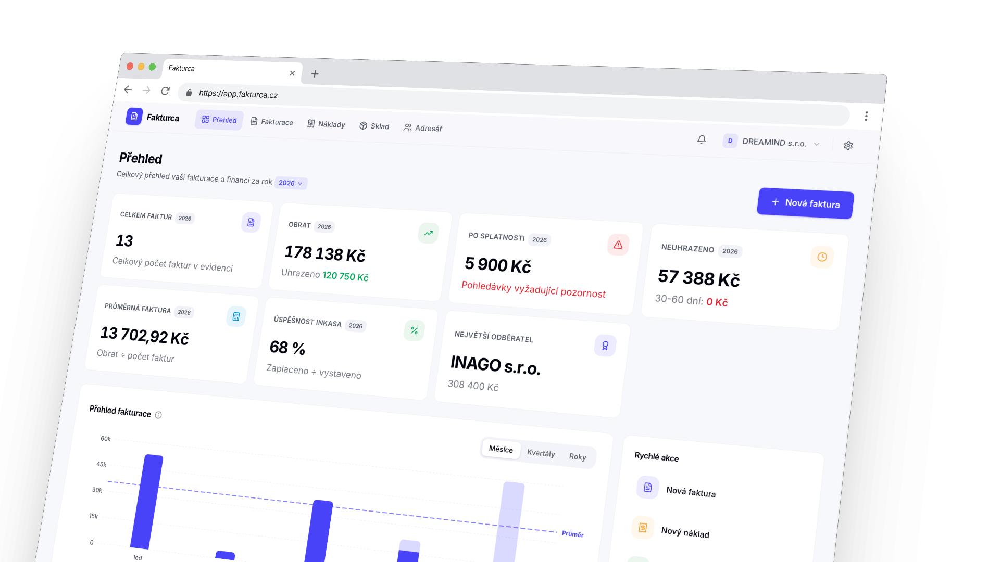
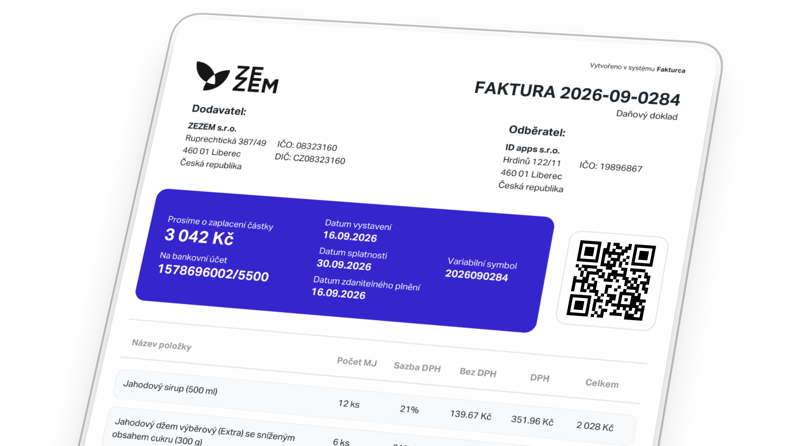

# Fakturca

Online invoicing for Czech freelancers and small companies: invoices, payment tracking, expenses, stock and contacts in one place. Live at [fakturca.cz](https://fakturca.cz), used by paying customers.

I am a co-owner and the main developer. This repository is a case study. The source code belongs to the company and is private.



## My role

- Built the frontend application and integrated it with the backend services.
- Made the product decisions: what to build, in what order, and how it should behave for the user.
- Reviewed the backend architecture, API robustness, security and performance.
- Designed the infrastructure and the deployment pipeline with future growth in mind.

1,269 of the 1,638 commits on the main branch are mine.

## What the product does

- **Invoices**: regular, proforma, credit notes and recurring invoices, with legally required numbering, VAT handling and a QR payment code. PDFs are rendered on the server from templates.
- **Payments**: who paid, who is overdue, reminders.
- **Expenses and stock**: received invoices, stock items and movements tied to invoice lines.
- **Contacts and companies**: an address book, several companies under one account, members with roles.
- **Automations, import, reports**: recurring tasks, migration from other invoicing tools, yearly overviews.
- **Subscriptions**: Free, Start, Business and Agency tiers with feature limits enforced on the server.



## Architecture

```
Browser
   │
Next.js app (React, server components and server actions)
   │   acts as a backend-for-frontend: session handling,
   │   an allowlisted proxy to the API
   ▼
ASP.NET Core API (.NET 9)
   ├─ business logic, persistence (EF Core)
   ├─ background jobs (Hangfire)
   ├─ PDF and e-mail templates (Razor)
   ▼
PostgreSQL · S3-compatible object storage
```

The frontend is split into about 30 feature modules (invoices, expenses, stock, contacts, payments, reports, onboarding and so on). Modules talk to each other only through declared entry points, and a custom ESLint rule fails the build when an import crosses a boundary.

## Stack

| Part | Technology |
|---|---|
| Frontend | Next.js 16, React 19, TypeScript, Tailwind CSS 4, TanStack Query and Table, next-intl, Recharts |
| Backend | C#, .NET 9, ASP.NET Core, Entity Framework Core, Hangfire, Razor templates |
| Data | PostgreSQL, S3-compatible storage |
| Auth | ASP.NET Core Identity, JWT, passkeys (WebAuthn), multi-factor authentication |
| Testing | Vitest and Testing Library, Playwright, xUnit with Testcontainers |
| Operations | Docker, Coolify, GitHub Actions, PostHog, structured logging |

## How it is kept healthy

- About 350 frontend and 260 backend test files. Backend tests run against a real PostgreSQL in a container.
- CI runs lint, type check, tests, architecture checks and translation parity checks on every pull request. A merge to main deploys production, and the backend applies database migrations on start.
- 140+ database migrations so far. A CI check fails when the model changes without a migration.
- Much of the 2026 work was done with AI coding agents. The guard rails above exist so that this stays safe: rules a machine can check live in lint and CI, not in a document.
